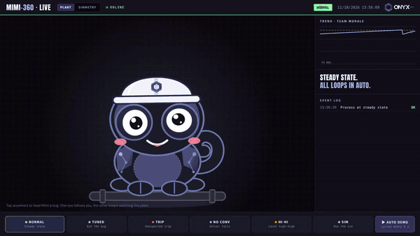

# MIMI-360 · Onyx 360 Mascot

Mimi is an onyx chameleon. She mimics the plant (MIMIC), sees nearly 360°, her tail curls into a control loop, and her color changes with plant state.

**Live demo:** https://onyx-360.github.io/MIMI/

## What's here

| Path | What it is |
|---|---|
| `index.html` | Live, animated Mimi. Plant mode and TwinSync mode. Works on phones. |
| `slides/` | Submission slides: general arrangement, operator view, swag, QR, plush tech pack |
| `stickers/` | Teams stickers: 8 states as PNG and animated GIF |
| `Mimi_Mascot_Submission.pdf` | All slides in one PDF |

TwinSync numbers in the demo are sample data.
